# weather_landscape

## What This Is

Every project needs a shelf of ready answers. product and engineering is one of those shelves, and weather_landscape is the entry on it - the notes, patterns and fixes we reuse when this kind of work comes up.

## Images

[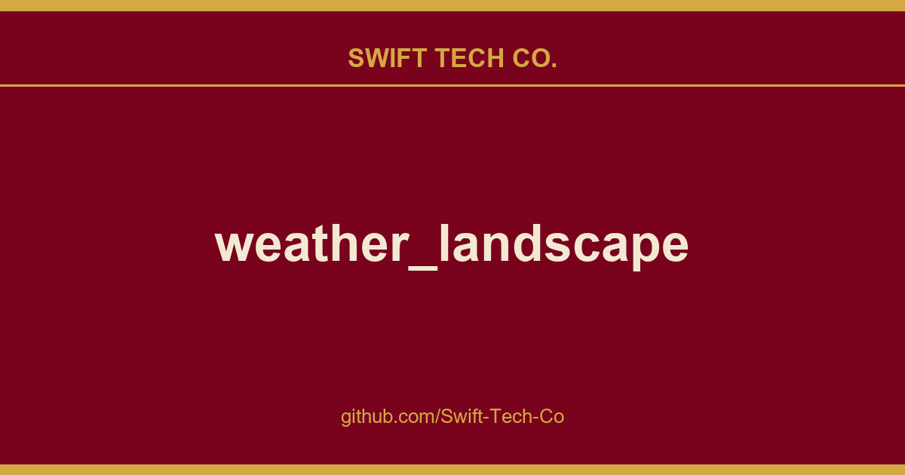](https://github.com/Swift-Tech-Co)

## Encoding principles

The landscape depicts a small house in the woods. The horizontal axis of the image represents a 24-hour timeline, starting from the current moment on the left, marked by the house, and extending to the conditions of the next day on the right. Various landscape elements distributed along the vertical axis symbolize weather events and conditions. The further an event is from the present, the farther it is positioned to the right in the image.


[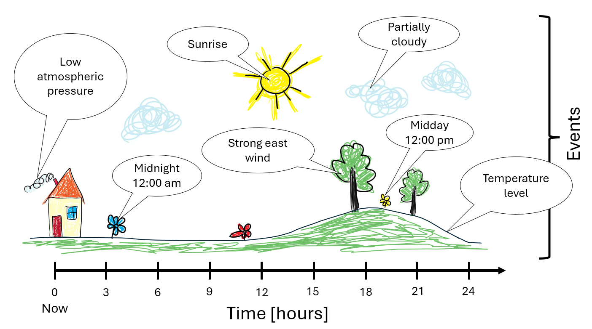](https://www.swifttechco.com)


The following information can be encoded within the landscape image:

- Time markers to simplify timeline navigation:
  - Sunrise and sunset times
  - Noon and midnight
- Weather forecast information:
  - Wind direction and strength
  - Temperature fluctuations
  - Maximum and minimum temperature values
  - Cloud cover
  - Precipitation
- Current weather conditions:
  - Temperature
  - Atmospheric pressure
- Non weather events:
  - Birthdays
  - Holidays
  


## Implementation

The image generation code is written in Python using the Pillow library and is based on data from OpenWeather. The image is designed specifically for use on a 296x128 E-Ink display. The code tested on Python 3.9.


| Event image | Description |
|----------|------------|
|[](https://www.swifttechco.com)| Sunrise | 
|[](https://www.swifttechco.com)| Sunset |
|[](https://www.swifttechco.com)| Cloud cover |
|[](https://www.swifttechco.com)| Current time position|
|[](https://www.swifttechco.com)| Midnight |
|[](https://www.swifttechco.com)| Midday |
|[](https://www.swifttechco.com)| South wind |
|[](https://www.swifttechco.com)| East wind |
|[](https://www.swifttechco.com)| West wind |
|[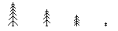](https://www.swifttechco.com)| North wind |
|[](https://www.swifttechco.com)| Rain|
|[](https://www.swifttechco.com)| Snow|
|[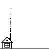](https://www.swifttechco.com)| High atmospheric pressure |
|[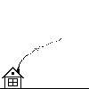](https://www.swifttechco.com)| Normal atmospheric pressure |
|[](https://www.swifttechco.com)| Low atmospheric pressure |
|[](https://www.swifttechco.com)| [Non-weather event](holiday.md): someone's birthday. |

The taller the trees, the stronger the wind is expected to be. A mix of different tree types in the forest indicates an intermediate wind direction.


## Examples

|&nbsp;Landscape&nbsp;image&nbsp;&nbsp;&nbsp;&nbsp;&nbsp;&nbsp;&nbsp;&nbsp;&nbsp;&nbsp;&nbsp;&nbsp;&nbsp;&nbsp;&nbsp;&nbsp;&nbsp;&nbsp;&nbsp;&nbsp;&nbsp;&nbsp;&nbsp;&nbsp;&nbsp;&nbsp;&nbsp;&nbsp;&nbsp;&nbsp;&nbsp;&nbsp;&nbsp;&nbsp;&nbsp;&nbsp;&nbsp;&nbsp;| Description |
|----------|------------|
|[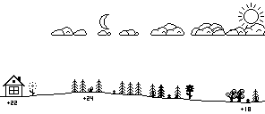](https://www.swifttechco.com)| It’s around noon, with clear skies and a few clouds expected. A moderate north wind will develop overnight. Temperatures are currently rising but will begin to fall after sunset, reaching their lowest point before sunrise. During this time, the wind is expected to shift to the northeast.|
|[](https://www.swifttechco.com)| The sun is rising and it will be a hot sunny day with a light southeast breeze. The temperature will remain high even after sunset, and the wind will shift to the east, becoming stronger throughout the evening.|
|[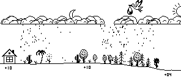](https://www.swifttechco.com)| It will be cold and rainy throughout the day and night. The south wind will shift to the northwest overnight. Don’t forget that someone’s birthday is tomorrow. |


## How the landscape changed during the day

[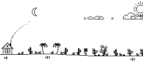](https://www.swifttechco.com)


## Running the code


#### Preparing environment Linux
```
./makevenv.sh
```
```
source .venv/bin/activate
```

#### Preparing environment Windows
```
makevenv.bat
```
```
.venv/Scripts/Activate
```

#### Image creation test

Update **OWM_KEY** variable in the `secrets.py` with your OpenWeather API key.

(optional) Change the coordinates in `secrets.py` to your location.

```
python run_test.py
```

Find generated images in the "tmp" folder.

#### Run server

```
python run_server.py
```

[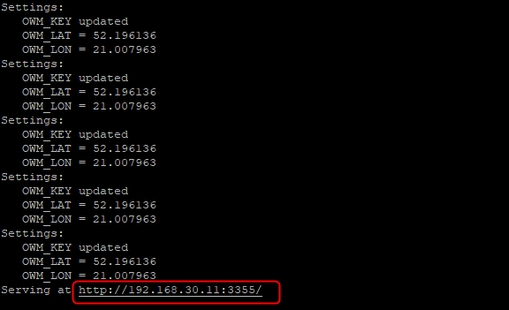](https://www.swifttechco.com)

Access the server page from a browser to see the number of generated images.


## E-Ink module

<!-- [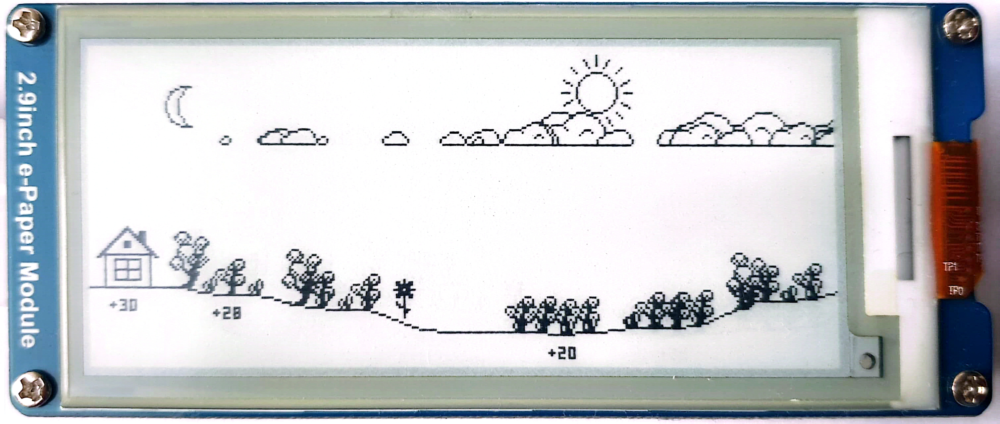](https://www.swifttechco.com) -->
[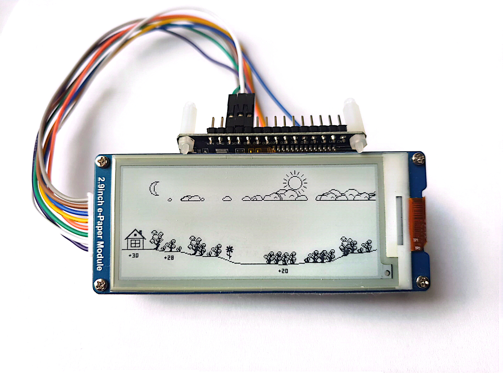](https://www.swifttechco.com)

The hardware setup includes an ESP32 development board and 2.9inch E-Ink display module. Currently, the setup only displays an image sourced from the internet, updating every 15 minutes. It is uncertain whether the image generation code can be adapted for use with MicroPython on the ESP32 at this time.

[More information](esp32/README.md)


## Phone

[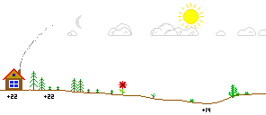](https://www.swifttechco.com)

During the test, several images are generated. The black-and-white images are intended for use with an E-Ink module, while the color images can be placed on a phone's home screen. For Android devices, there is an app called Web Image Widget that allows you to create a widget displaying an image from the internet. To use it, start the server script from the repository and add a widget that points to one of the generated images.

[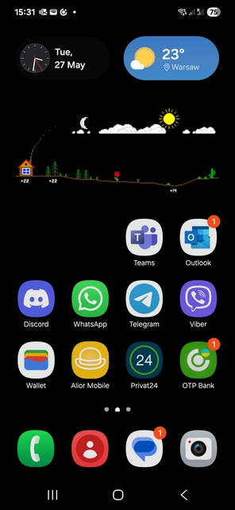](https://www.swifttechco.com)

---

## Swift Tech Co.

Built and maintained by Swift Tech Co.

AI Automation | FinTech Platforms | Custom Software and Mobile Apps | SaaS Platforms | Cloud Infrastructure | Cybersecurity | SEO and Marketing | API Integration

**Join our community on Telegram:** [t.me/+Qt_eFvkb2rliMzNh](https://t.me/+Qt_eFvkb2rliMzNh)

Home | Services | Careers | Referral Program | Influencers | About | Contact

**Connect**

- Website: swifttechco.com
- LinkedIn: [linkedin.com/in/stephenoladoke](https://www.linkedin.com/in/stephenoladoke/)
- LinkedIn (Company): [linkedin.com/company/swift-tech-co](https://www.linkedin.com/company/swift-tech-co)
- X: [@MrOladoke](https://x.com/MrOladoke)
- Instagram: [@mr.oladoke](https://www.instagram.com/mr.oladoke/)
- Instagram (Company): [@swifttechco](https://www.instagram.com/swifttechco/)
- Organization: [github.com/Swift-Tech-Co](https://github.com/Swift-Tech-Co)

## Sources

Compiled and maintained from upstream [lds133/weather_landscape](https://github.com/lds133/weather_landscape) under permissive open-source license.

---

Maintained by [Swift Tech Co.](https://github.com/Swift-Tech-Co) - [Telegram](https://t.me/+Qt_eFvkb2rliMzNh)